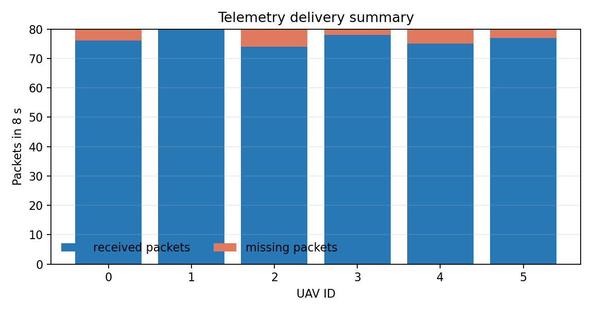

# FleetPulse: UAV Telemetry Bridge

A reproducible six-UAV telemetry example built around asyncio UDP datagrams. The demo models periodic state reports, packet loss, sequence numbers, and a ground-station aggregator.

## Run

```text
python telemetry_demo.py --agents 6 --duration 8 --drop-rate 0.05
```

The demo uses loopback UDP ports `15000-15005`, so it runs without flight hardware. The output reports received packets, loss estimates, and the latest state for each simulated UAV.

## Design

- One telemetry socket per simulated vehicle.
- A ground station listens on a separate UDP port.
- JSON packets carry `agent_id`, `seq`, timestamp, position, velocity, and battery.
- The loss model is explicit and reproducible with `--seed`.

This is a software-in-the-loop communication example. It does not claim to be a flight-control or safety-certified protocol.



The figure summarizes packet delivery from a representative six-agent run.

## License

MIT
